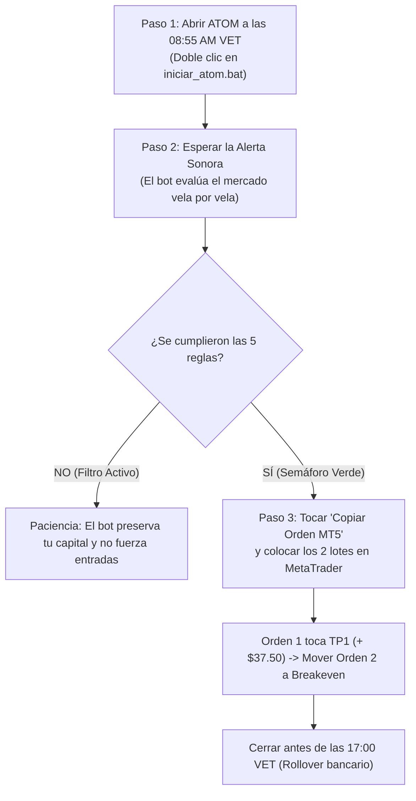

# 🧠 MEMORIA MAESTRA DEL PROYECTO ATOM ⚛️
> **Versión:** 2.0 (Diseño Intuitivo Institucional)  
> **Propósito:** Plataforma Cuantitativa y Copiloto Autónomo para operar Oro (`XAU/USD`) en cuentas de evaluación y fondeadas de **$10,000 USD en FundingPips**, operada desde Venezuela (`VET UTC-4`).  
> **Prompt de Continuidad:** *"Lee el archivo MEMORIA_DEL_PROYECTO_ATOM.md de este repositorio y continúa ayudándome a operar y automatizar ATOM"*.

---

## 🧭 PARTE 1: EXPLICACIÓN SENCILLA PARA PRINCIPIANTES (Cero Conocimiento Técnico)

### 1. ¿Qué es ATOM y qué hace por ti?
Imagina que tienes a un analista matemático profesional sentado a tu lado las 24 horas del día observando el precio del oro.
* **El bot hace el 100% del trabajo pesado:** Monitorea las noticias de EE.UU., calcula los horarios seguros, detecta los engaños del mercado, mide la fuerza del movimiento y calcula exactamente cuánto dinero arriesgar para que **nunca pierdas tu cuenta**.
* **Tu único trabajo es:** Cuando el bot hace sonar la campana y te muestra el cartel verde de **`OPORTUNIDAD DETECTADA`**, tocas el botón verde de **Copiar**, abres tu MetaTrader en el teléfono o la computadora y pegas la orden.

---

### 2. Las 5 Reglas de Oro explicadas con sentido común

| Regla | Nombre Técnico | ¿Qué significa en lenguaje humano? |
| :---: | :--- | :--- |
| **R1** | **Horario Seguro & Filtro Macro** | **No cruzar la calle a ciegas.** Solo operamos en el horario donde hay más movimiento claro (**09:00 a 11:30 AM hora de Venezuela**) y nos quedamos quietos si el gobierno de EE.UU. va a dar una noticia de alto impacto (bloqueo de $\pm 5$ minutos). |
| **R2** | **Falso Engaño del Mercado (Sweep)** | **La trampa de los grandes bancos.** Los bancos empujan el precio con una mecha rápida para engañar a los novatos haciéndoles creer que el precio se va a disparar, y luego lo regresan adentro. ATOM espera pacientemente ese engaño para entrar en la dirección contraria. |
| **R3** | **Confirmación de Fuerza (CISD $\ge 50\%$)** | **No adivinar, esperar a que los grandes muestren sus cartas.** Una vez hecho el engaño, exigimos ver una vela fuerte y sólida (donde el cuerpo sea más de la mitad del tamaño total) que confirme que el dinero inteligente tomó el control. |
| **R4** | **Punto Óptimo con Descuento (FVG 50% CE)** | **Comprar con descuento y vender caro.** Nunca perseguimos el precio cuando ya se fue. Esperamos que el mercado haga una pausa y regrese a un hueco de precio justo al **50% (Punto Medio / CE)** para montarnos en el viaje con el mejor precio posible. |
| **R5** | **Blindaje de Capital (\$50 USD & Ganancia Doble)** | **Proteger tu cuenta pase lo que pase.** Si una operación sale mal, **lo máximo que puedes perder son \$50 dólares (0.5% de \$10K)**. Además, dividimos la operación en 2 partes: la primera mitad cobra beneficio rápido (**+\$37.50 USD**) y pone el seguro en cero (**Breakeven**, riesgo cero), y la segunda mitad corre hasta ganar **+\$75.00 USD**. Si tenemos 2 derrotas en un día (-\$100), la plataforma se apaga hasta mañana para que jamás pierdas la prueba de fondeo. |

---

### 3. La Rutina Diaria de 3 Pasos (Tu día a día)

1. **08:55 AM (VET):** Abres la plataforma en `http://127.0.0.1:8050`.
2. **09:00 a 11:30 AM:** Dejas la pestaña abierta. El Guardián revisa todo automáticamente.
3. **Al sonar la campana:** Aparece el recuadro con los datos. Copias el boleto y colocas la orden en tu MetaTrader.
4. **Antes de las 5:00 PM (17:00 VET):** Si la orden no ha tocado su objetivo antes del cierre bancario, se cierra manualmente a mercado para evitar los spreads gigantescos y comisiones de la noche.

---

## ⚙️ PARTE 2: ESPECIFICACIONES TÉCNICAS INSTITUCIONALES (Para Desarrolladores y Agentes)

### 1. Parámetros del Entorno
- **Broker / Firma:** FundingPips ($10,000 USD Standard / Evaluation).
- **Zona Horaria Maestra:** Venezuela Time (`VET` = `UTC-4`, `America/Caracas`).
- **Sincronización CME:** NY Time (`EDT`/`EST` = `America/New_York`).
- **Activos:** Oro Spot / Futuros CME (`GC=F` / `XAUUSD` / `PAXGUSDT` 24/7).
- **Servidor:** Starlette ASGI + Uvicorn en `http://127.0.0.1:8050`.
- **Tema Visual:** Legacy Dark (`Fondo: #101010`, `Bordes: #21262d`, `Texto: #CCCCCC`, `Acento: #007ACC`).

### 2. Parámetros Cuantitativos de Riesgo
- **Tamaño de Cuenta:** \$10,000.00 USD.
- **Riesgo por Setup:** 0.50% estricto = **\$50.00 USD**.
- **Buffer de Stop Loss:** +$1.20 pts tras el extremo de la mecha del sweep.
- **Rango permitido de Stop Loss:** Mínimo \$2.50 pts / Máximo \$10.00 pts (25 a 100 pips).
- **Fórmula de Lotaje MT5:**
  $$\text{Lotes Totales} = \frac{\text{Riesgo USD}}{\text{Distancia Stop (pts)} \times 100}$$
  $$\text{Orden 1 (Lotes)} = \text{round}\left(\frac{\text{Lotes Totales}}{2}, 2\right), \quad \text{Orden 2 (Lotes)} = \text{round}\left(\frac{\text{Lotes Totales}}{2}, 2\right)$$
- **Protocolo Split 50/50:**
  - **Orden 1 (50% volumen):** Take Profit 1 a **1:1.5R** ($+\$37.50\text{ USD}$). Al tocar TP1 $\rightarrow$ Stop Loss de Orden 2 se mueve a **Breakeven** (precio de entrada).
  - **Orden 2 (50% volumen):** Take Profit 2 a **1:3.0R** ($+\$75.00\text{ USD}$) buscando liquidez externa.
  - **Beneficio neto combinado:** $+\$112.50\text{ USD}$ ($+2.25\text{R}$).
- **Circuit Breaker Diario:** Máximo 2 Stop Loss consecutivos en un mismo día ($-\$100.00\text{ USD} = -1.0\%$). Al tocar el segundo SL se desactiva el trading hasta el día siguiente. Límite diario de FundingPips es $-5\%$ ($-\$500$), por lo que el colchón de seguridad es del 80%.

---

## 📚 PARTE 3: DICCIONARIO RÁPIDO DE TÉRMINOS (GLOSARIO)

* **XAU/USD:** Símbolo internacional del Oro cotizado contra el Dólar estadounidense. $1.00 punto en oro equivale a 10 pips.
* **Killzone NY:** Ventana horaria de 09:00 a 11:30 AM hora de Venezuela donde abren los bancos y la bolsa de Nueva York, generando el volumen más limpio del día.
* **Sweep / Barrido de Liquidez:** Movimiento rápido donde una mecha supera un máximo o mínimo previo para activar las órdenes de los traders minoristas antes de revertir.
* **Asian Range / London Range:** El rango de precios máximo y mínimo que formó el mercado durante la noche en Tokio/Londres.
* **PDH / PDL:** *Previous Day High* / *Previous Day Low* (Máximo y mínimo del día anterior).
* **CISD (*Change in State of Delivery*):** Vela con cuerpo amplio que rompe la estructura previa y confirma que los bancos cambiaron de compra a venta (o viceversa).
* **FVG (*Fair Value Gap*):** Hueco de ineficiencia dejado por una vela rápida de 3 barras donde el mercado no tuvo tiempo de negociar equitativamente.
* **50% CE (*Consequent Encroachment*):** La mitad exacta del FVG. Es el punto con mayor probabilidad matemática de rebote y el mejor precio de entrada.
* **Breakeven (BE):** Mover el Stop Loss al precio de entrada para que, si el mercado se regresa, la pérdida sea exactamente \$0.00.
* **Rollover (17:00 VET):** Hora en que los bancos mundiales liquidan contratos del día. Se suspende la operativa para evitar spreads abusivos.

---

## 🗂️ PARTE 4: ARQUITECTURA DE ARCHIVOS

- `gold_assistant/ares_server.py`: Servidor local web Starlette/Uvicorn (`http://127.0.0.1:8050`).
- `gold_assistant/ares_market_feed.py`: Flujo en vivo de Yahoo Finance CME v8, ForexFactory y zonas horarias.
- `gold_assistant/ares_smc_engine.py`: Motor cuantitativo de las 5 Reglas, detección automática de Sweeps/CISD/FVG y generador de boletos MT5.
- `gold_assistant/ares_backtest_journal.py`: Backtester de 60 días, simulador de escalado y base de datos SQLite `ares_data.db`.
- `gold_assistant/static/index.html`: Interfaz táctica intuitiva con semáforo y disparador sniper.
- `gold_assistant/static/app.js`: Lógica interactiva, sintetizador de audio y conexión en tiempo real.
- `gold_assistant/static/styles.css`: Estilos Legacy Dark de alto contraste visual.
